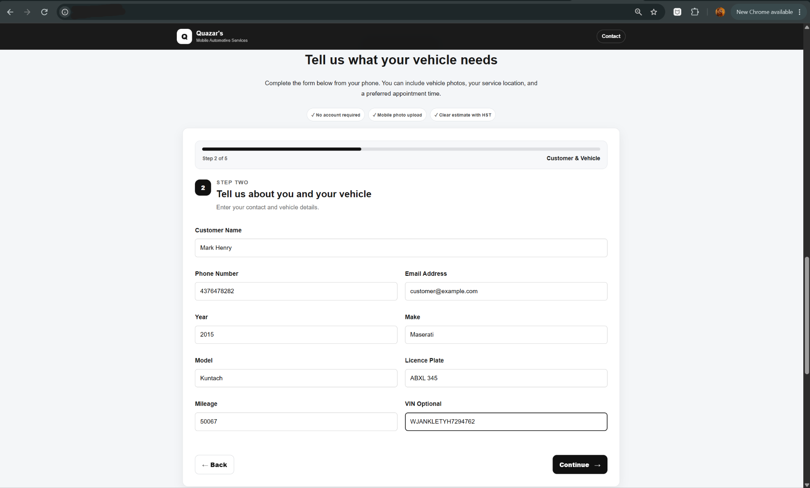
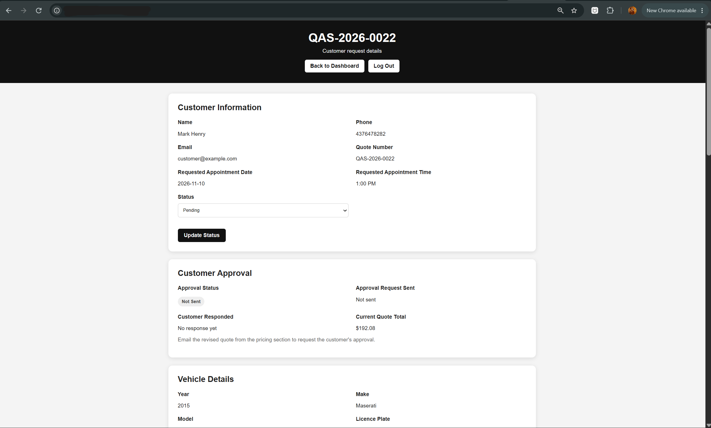

# Automotive Service Quote Management

I built a web app with Python, Flask, and SQLite to manage quotes for mobile automotive services. Customers can submit vehicle details and track their quotes. Staff can review requests, update pricing and quote status, and track customer approval.

## Customer quote request

The customer enters contact and vehicle details in a guided form.

## Admin quote detail

Staff can view the requested appointment, update the quote status, and see the current total and approval status.

